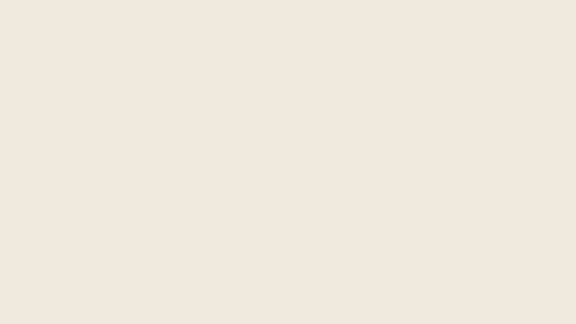

# SHERIPOV — новая заставка

Обновление взаимодействий и синтезированного звука: [проверки и ссылки](../../verification/site-polish-2026-10-29/README.md).

Точные контуры из мастер-файлов владельца в `../2026-10-26/`. В полном логотипе синяя точка стоит в конце. В коротком — после SH.

S рисуется по направлению штриха; H собирается тремя движениями. Компактная композиция раскрывается из центра: точка движется вправо и проявляет неподвижные буквы ERIPOV. После остановки — пауза и переход готового знака в шапку. Без столкновений, отскоков, частиц и подмены авторских букв шрифтом.

- Просмотр: https://suleyman-sheripov.github.io/design/brand-motion/
- Видео: https://suleyman-sheripov.github.io/design/brand-motion/SHERIPOV-motion-1080p.mp4
- Автономный HTML: `app/public/brand-motion/index.html` — можно скачать и открыть без интернета.
- MP4: 1920 × 1080, 60 fps, 5 секунд; запись реального SVG-рендера браузера. Фирменная сцена занимает 3,72 секунды, оставшееся время — финальный кадр.



## Код и запуск

`app/src/lib/logoPaths.ts` хранит исходные контуры. `introSim.ts` задаёт время и положение элементов, `BrandLogo.tsx` — маски раскрытия. И сайт, и автономный просмотр используют эти же компоненты. `Intro.tsx` управляет завершением, блокировкой прокрутки и пропуском. `Lockup.tsx` переносит полный вектор в шапку.

```
npm ci --prefix app
npm run dev --prefix app
node app/scripts/export-logo-motion.mjs
npm test --prefix app
npm run lint --prefix app
npm run build --prefix app
npm run check:content --prefix app
```

При изменении анимации пересобрать автономный просмотр командой `export-logo-motion.mjs`. MP4 и GIF — снимок этой версии, автоматически при сборке сайта не перезаписываются.

Браузерная проверка (Python, Playwright, Pillow и Chromium):

```
python app/scripts/check-logo-motion.py http://localhost:5173/design/ /tmp/sheripov-motion-check
```

117 тестов проходят. Сборка и проверка контента проходят. Lint: 0 ошибок, 5 существующих предупреждений React в App, Cursor, Symbiote и Typed. Проверены 1440 px и 390 px, точные финальные контуры, слои при переходе в шапку, пропуск с клавиатуры, повторная загрузка, reduced motion, завершение без rAF, открытие/обновление кейса и загрузка админки. Вход и запись через GitHub в этой задаче не менялись.

Новые Mark/Lockup/introSim заменяют прежний знак и физику по прямому запросу владельца. `docs/verification/protected-files.json` остаётся историческим снимком прежней принятой версии, а не контрольной суммой этого обновления.

Ранее экспортированные баннеры, PDF логобука и кейса этим коммитом не пересобираются.
